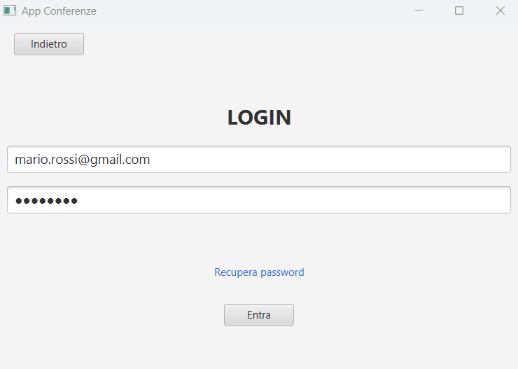
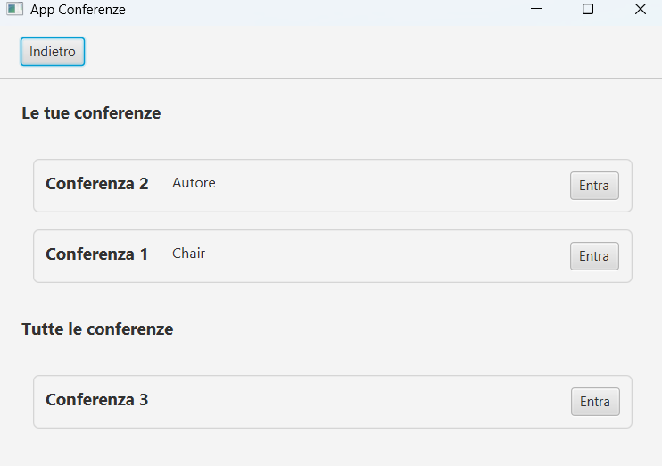
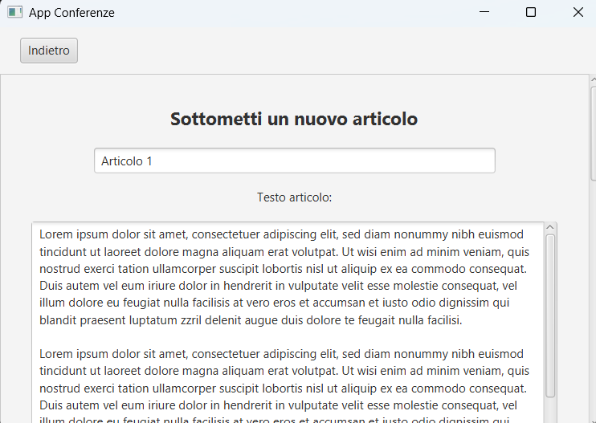

# App Conferenze

Conference Management System (CMS) per la gestione del ciclo di vita di una conferenza scientifica, dalla creazione dell'evento alla sottomissione, assegnazione, revisione e valutazione degli articoli.

Il progetto è stato sviluppato come progetto universitario di Ingegneria del Software a partire da una specifica relativa alla gestione di conferenze, comitati di programma e processi di peer review.

## Contesto

L'organizzazione di una conferenza scientifica è un processo composto da più fasi e coinvolge autori, chair, revisori, sotto-revisori ed editor. Il sistema supporta la collaborazione tra questi ruoli durante la raccolta degli articoli, la loro distribuzione ai revisori, la gestione delle recensioni e la preparazione delle versioni finali.

La specifica prevede inoltre il controllo delle scadenze, la possibilità per il chair di supervisionare le assegnazioni e diversi criteri di distribuzione degli articoli, tra cui la distribuzione automatica e il broadcast con sistema di offerte.

## Funzionalità principali

- Registrazione, autenticazione e gestione degli utenti.
- Creazione e modifica delle conferenze, con date, scadenze, luogo, argomenti e numero massimo di articoli.
- Gestione dei ruoli all'interno di una conferenza:
  autore, revisore, sotto-revisore, chair ed editor.
- Sottomissione degli articoli tramite testo o file e associazione agli argomenti della conferenza.
- Proposta, assegnazione e distribuzione degli articoli ai revisori.
- Gestione delle revisioni, delle sotto-revisioni, dei commenti e delle valutazioni.
- Comunicazione tra i partecipanti tramite inviti, proposte di revisione e broadcast degli articoli.
- Invio della versione finale dell'articolo all'editor e visualizzazione dello stato del processo.
- Gestione delle scadenze della conferenza, della submission, della revisione, dell'accettazione e della final submission.

## Flusso applicativo

1. Un utente si registra e accede all'applicazione.
2. Il chair crea una conferenza definendo informazioni, argomenti e scadenze.
3. Il chair invita i partecipanti e assegna i ruoli di chair, revisore, sotto-revisore ed editor.
4. Gli autori sottomettono i propri articoli selezionando gli argomenti di interesse.
5. Gli articoli vengono distribuiti ai revisori tramite assegnazione automatica oppure broadcast con sistema di offerte.
6. I revisori accettano gli incarichi ed effettuano la valutazione con commenti e punteggi.
7. Quando necessario, i revisori coinvolgono i sotto-revisori e consultano le relative valutazioni.
8. Il chair controlla le revisioni, decide l'esito degli articoli e gestisce la fase finale.
9. L'editor riceve gli articoli finali per la preparazione dei proceedings.

## Tecnologie

- **Java**
- **JavaFX** per l'interfaccia grafica
- **FXML** per la definizione delle schermate
- **SQLite** per la persistenza locale dei dati
- **JDBC** tramite `sqlite-jdbc`
- **Visual Studio Code** con il supporto Java

## Architettura

Il progetto segue una separazione a livelli:

- `controllers/`: gestiscono gli eventi e l'interazione con le schermate JavaFX.
- `views/`: contengono le schermate FXML.
- `services/`: implementano la logica applicativa.
- `data/dao/`: gestiscono l'accesso ai dati tramite query SQL.
- `models/`: contengono le entità del dominio.
- `utils/`: includono la gestione del database, delle scene e della sessione utente.

Il flusso principale delle operazioni è:

```text
JavaFX/FXML
    ↓
Controller
    ↓
Service
    ↓
DAO
    ↓
SQLite
```

## Struttura del progetto

```text
App_Conferenze/
├── src/
│   ├── controllers/
│   ├── data/dao/
│   ├── models/
│   ├── services/
│   ├── utils/
│   ├── views/
│   └── Main.java
├── lib/
│   └── sqlite-jdbc-3.49.1.0.jar
├── docs/
│   └── screenshots/
├── uploads/
├── .vscode/
└── README.md
```

La cartella `bin/`, se presente, contiene i file `.class` compilati e non è necessaria per comprendere il codice sorgente.

## Requisiti

- JDK 22 o versione compatibile con il progetto.
- JavaFX SDK 24.0.1.
- Visual Studio Code con le estensioni **Extension Pack for Java** e **Debugger for Java**.

## Avvio in Visual Studio Code

1. Clonare o scaricare il repository.
2. Aprire la cartella del progetto in Visual Studio Code.
3. Verificare che il percorso del JavaFX SDK nella configurazione di avvio corrisponda al proprio computer.
4. Aprire `src/Main.java`.
5. Avviare la configurazione **Esegui App Conferenze** oppure eseguire il metodo `main`.

La configurazione del progetto utilizza:

- `src` come cartella dei sorgenti;
- `bin` come cartella di output della compilazione;
- `lib/sqlite-jdbc-3.49.1.0.jar` come dipendenza SQLite.

## Screenshot

L'interfaccia è volutamente semplice, in linea con le indicazioni del progetto universitario. Gli screenshot mostrano comunque i principali flussi applicativi e rendono più immediata la comprensione del sistema.

### Autenticazione



### Gestione delle conferenze



### Sottomissione di un articolo




Gli screenshot utilizzano esclusivamente dati fittizi e hanno uno scopo dimostrativo.

## Database e file caricati

Il database SQLite viene creato e inizializzato automaticamente all'avvio tramite `DatabaseManager`. Il file locale `app.db` contiene i dati creati durante l'utilizzo dell'applicazione.

Gli articoli salvati come file vengono memorizzati nella cartella `uploads/`.

Per una nuova installazione è possibile eliminare `app.db`: al successivo avvio l'applicazione ricreerà la struttura del database. I dati presenti nel database e nella cartella `uploads/` sono dati locali di test.

## Documentazione di progetto

La documentazione del progetto può essere completata aggiungendo al repository:

- diagramma dei casi d'uso;
- diagramma delle classi;
- diagramma delle attività del processo di revisione;
- diagramma di sequenza per la sottomissione e revisione di un articolo.

Questi diagrammi descrivono i requisiti della specifica, gli attori coinvolti e le principali decisioni progettuali del sistema.

## Obiettivo didattico

Il progetto applica i concetti di analisi e progettazione del software a un dominio con più attori, ruoli e flussi operativi. In particolare, il sistema mette in evidenza la separazione tra interfaccia grafica, logica applicativa e persistenza dei dati, oltre alla gestione delle relazioni tra utenti, conferenze, articoli e revisioni.

## Autore

- [@giuseppealba-dev](https://github.com/giuseppealba-dev)

## Stato del progetto

Progetto universitario funzionante per scopi didattici e dimostrativi. L'applicazione utilizza una persistenza locale SQLite e non include un'infrastruttura server per l'utilizzo multiutente in rete.
